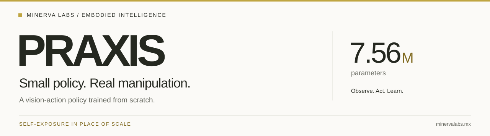
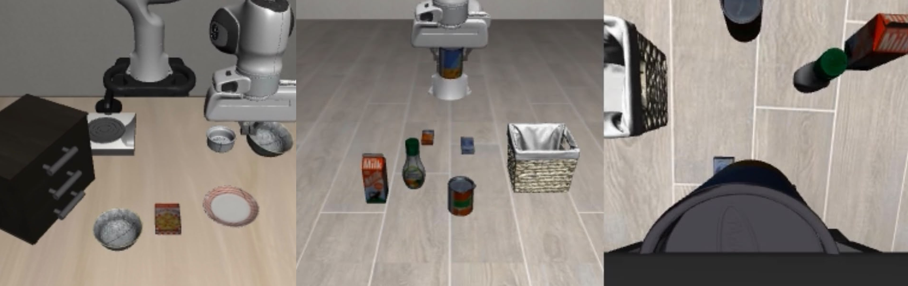
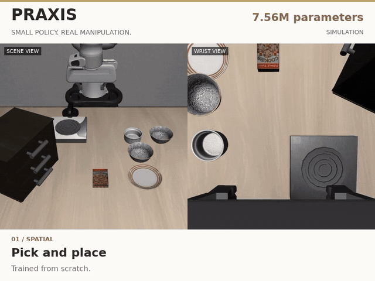
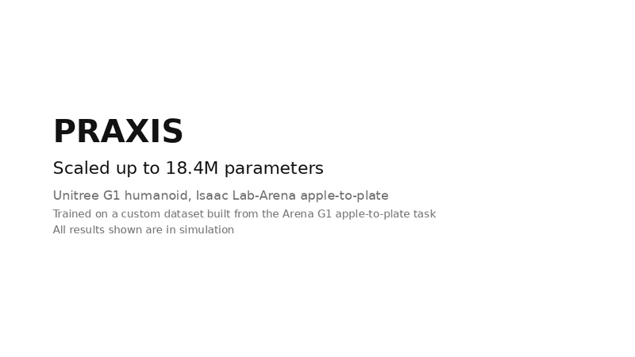
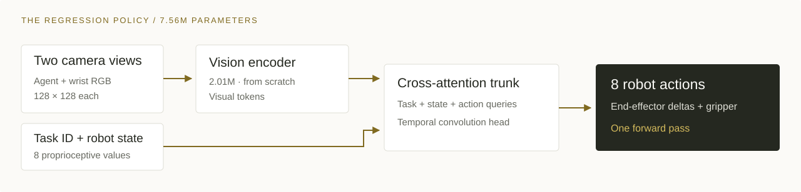

<div align="center">



**Two cameras. A task ID. Eight robot actions in one forward pass.**

PRAXIS is a compact robot manipulation policy. It learns from the states its own actions produce,
using demonstration-derived labels instead of an interactive expert.

[**See it move**](#see-it-move) · [**The idea**](#the-idea) · [**Results**](#results) · [**Try it**](#try-it) · [**NEmo 2026 poster**](https://nemo.semantic.review/#papers)



| **7.56M** parameters | **2.01M** vision encoder | **83.1%** reported LIBERO success | **From scratch** |
|:---:|:---:|:---:|:---:|
| Regression policy | No pretrained backbone | Four suites · 40 tasks | No language model or language input |

</div>

The 83.1% result is the paper's mean across three training runs. The two checkpoints in this
repository are earlier snapshots, scoring 78.0% and 79.5% under their recorded protocol.
[Paper protocol and released checkpoints →](#results)

## See it move

<table>
<tr>
<th width="50%">LIBERO · 7.56M parameters</th>
<th width="50%">Arena G1 · 18.4M parameters</th>
</tr>
<tr>
<td></td>
<td></td>
</tr>
<tr>
<td>Arm manipulation · 22.4-second highlights</td>
<td>Humanoid manipulation · 7.8-second demonstration</td>
</tr>
</table>

[Watch the full LIBERO demonstration (60.4 seconds)](docs/assets/libero.gif).

Both are simulation demos. The 83.1% result above belongs to the **7.56M LIBERO regression policy**.
The Arena G1 clip shows a separate 18.4M variant; its implementation, weights and evaluation are not
included in this release. [Media provenance](docs/assets/README.md).

## The idea

A robot trained only on expert trajectories eventually reaches a state the expert never visited.
Training should include those states, too.

**SEAL — Self-Exposure with Aligned Labels** makes that practical for a fixed set of tasks:

1. **Start from a demonstration.** Restore a simulator state along the recorded trajectory.
2. **Let the policy act.** Roll out one eight-step observation interval, including its mistakes.
3. **Label what it actually visited.** Use the aligned demonstration actions, optionally adding an analytic recovery correction.
4. **Train and repeat.** Mix the new states with demonstration data and update the policy.

The demonstration supplies the labels; no interactive expert or learned dynamics model is needed.
In the paper, self-exposure with demonstration actions reaches **81.5%** mean success;
adding analytic correction reaches **83.1%**. The correction's additional benefit is statistically
unresolved in these runs. The main finding is the value of **training on the policy's own state distribution**.



The regression policy uses two 128 × 128 views, an eight-dimensional robot state and a learned task
embedding. A cross-attention trunk and temporal convolutional head produce the complete action chunk.
The robot executes the chunk, observes again and replans. This is control of **known task identities**,
not open-ended language instruction following.

## Results

Paper results on LIBERO, MuJoCo 3.9: 40 tasks, 20 evaluation episodes per task and training run.
Values are success percentages; parameter counts are those needed at inference.

| Policy | Parameters | Spatial | Object | Goal | Long horizon | Mean |
|:---|---:|---:|---:|---:|---:|---:|
| **PRAXIS · regression** | **7.56M** | **89.8** | **97.3** | 89.3 | **56.2** | **83.1** |
| PRAXIS · single-shot generative | 9.69M | 83.3 | 89.7 | **94.0** | 32.7 | 74.9 |

Both train from scratch. The generative variant uses 11.81M parameters during training and drops its
recognition encoder at inference. Regression is the stronger of these two variants in the controlled
paper comparison.

For scale context, the paper reports CT-VAM at 68M parameters and 82.1% mean success. That is about
9× the parameter count; it is a **cross-paper comparison**, with different environments and inputs,
not a matched rerun. PRAXIS is not the highest-scoring LIBERO model.

**Release checkpoints:** [regression, 78.0%](checkpoints/praxis-regression.pt) and
[generative, 79.5%](checkpoints/praxis-generative.pt), each from a single recorded
400-episode evaluation. They are not the three-run paper pair.

The paper describes three training seeds; the upstream reproducibility notes identify them as
independent unseeded runs. The figures above are reported paper results, not a fresh benchmark
of this refactor. Cross-system comparisons and run-to-run variation should be interpreted accordingly.

## Try it

Install the package from a clone. Python 3.10+ is required; the CPU checks run on Python 3.12.
Install the PyTorch build appropriate for your machine, then:

```bash
git clone https://github.com/Minerva-Laboratories/Praxis.git
cd Praxis
python -m venv .venv
source .venv/bin/activate
python -m pip install -e .
praxis --help
```

**Run the policy without a simulator.** This CPU smoke example uses synthetic observations to
show the API; it does not measure task success or command a robot.

```python
import numpy as np
from praxis.inference import PraxisPolicy

policy = PraxisPolicy("praxis-regression.pt", dev="cpu", deterministic=True)
images = np.zeros((1, 2, 128, 128, 3), dtype=np.uint8)
robot_state = policy.s_mean[None, :].copy()
actions = policy.act(images, robot_state, np.array([0]))
print(actions.shape)  # (1, 8, 7): batch, action steps, action dimensions
```

**Evaluate on LIBERO.** Install [LIBERO and its simulator assets](https://github.com/Lifelong-Robot-Learning/LIBERO#installation),
then check the environment and run the released regression policy:

```bash
praxis doctor
export MUJOCO_GL=egl
praxis evaluate \
  --ckpt checkpoints/praxis-regression.pt \
  --episodes 10 --workers 4 --deterministic
```

Evaluation defaults to CUDA; `--device cpu` is also supported. CUDA inference uses BF16 when
available, otherwise FP32. Training currently requires CUDA. Full LIBERO evaluation covers
40 tasks; a CPU API smoke test is much lighter. Packed training demonstrations are not required
for evaluation.

[Environment and training guide →](docs/reproduce.md) · [Dataset format →](docs/data-format.md)

## Explore the implementation

| Start here | What you will find |
|:---|:---|
| [`praxis/vision_eff.py`](praxis/vision_eff.py) | Compact vision encoder trained from scratch |
| [`praxis/policy_eff.py`](praxis/policy_eff.py) | Regression policy, action head and losses |
| [`praxis/seal.py`](praxis/seal.py) | Analytic recovery-label construction |
| [`praxis/train_eff.py`](praxis/train_eff.py) | Behavior cloning, fine-tuning and self-exposure rounds |
| [`praxis/rollout.py`](praxis/rollout.py) | Parallel simulator workers |
| [`praxis/inference.py`](praxis/inference.py) | Public observations → actions API |
| [`praxis/config.py`](praxis/config.py) | Asset paths, normalization and task-map validation |
| [`praxis/training_utils.py`](praxis/training_utils.py) | Shared training datasets and moving-average weights |
| [`praxis/policy_cvae_eff.py`](praxis/policy_cvae_eff.py) | Alternative single-shot conditional generative head |
| [`tests/`](tests/) | CPU inference, metadata, training helpers and worker lifecycle tests |

## Paper and project

**PRAXIS over Theoria: Self-Exposure in Place of Scale for Efficient Manipulation** is listed as an
accepted poster at [NEmo 2026, a NeurIPS workshop](https://nemo.semantic.review/#papers).
The workshop is non-archival. Results above follow the corrected submission supplied by the authors.
[Method and architecture notes](docs/method.md) explain how the implementation fits together.

```bibtex
@misc{hernandezgomez2026praxis,
  title  = {PRAXIS over Theoria: Self-Exposure in Place of Scale for Efficient Manipulation},
  author = {Hernandez Gomez, Alejandro and Sandoval Silva, Luis Fernando and
            Nieto Gutierrez, Nezih and Podesta Vezzali, Marco Ottavio and
            Muñoz Ubando, Luis Alberto},
  year   = {2026},
  note   = {Accepted poster, NEmo workshop at NeurIPS 2026; non-archival},
  url    = {https://nemo.semantic.review/}
}
```

This organization repository builds on the source from
[`alexhergomz/Praxis`](https://github.com/alexhergomz/Praxis), refactored into a focused package by Minerva Labs. It includes the supplied demos, a documented API,
training/evaluation commands and CPU tests. Historical experiment indexes and logs are excluded
from the current source tree. The original checkout did not include
a license file; no license has been assigned here. [Contributing](CONTRIBUTING.md).

---

**[Minerva Labs](https://www.minervalabs.mx/)** · Small models. Real work.

We build compact AI for the hardware you already have.
[Explore the lab](https://www.minervalabs.mx/) · [Report an issue](https://github.com/Minerva-Laboratories/Praxis/issues)
